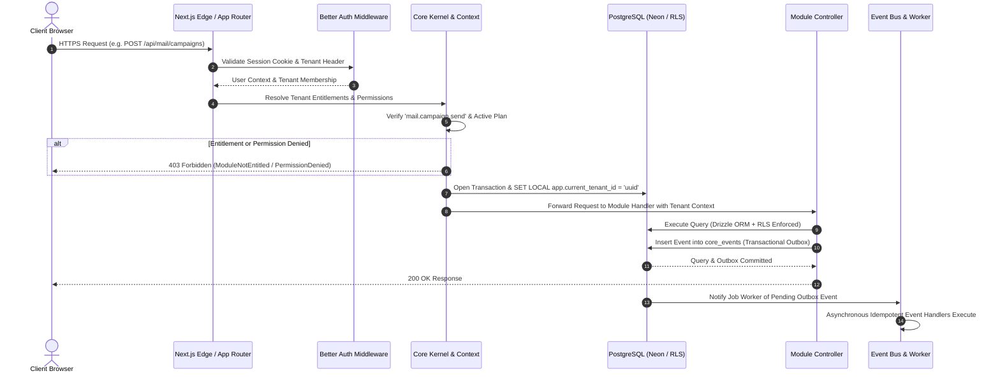
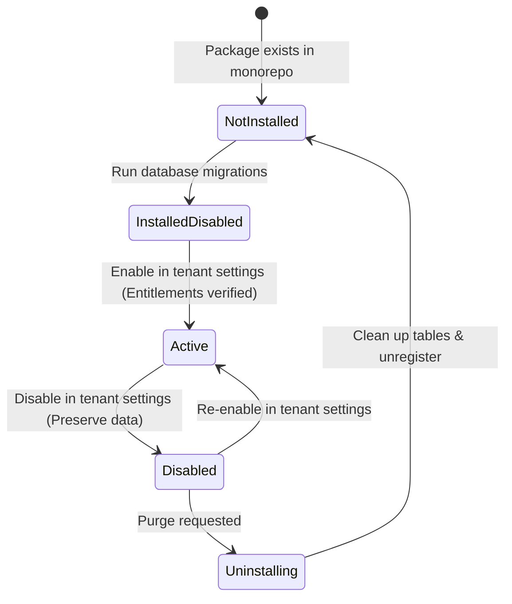
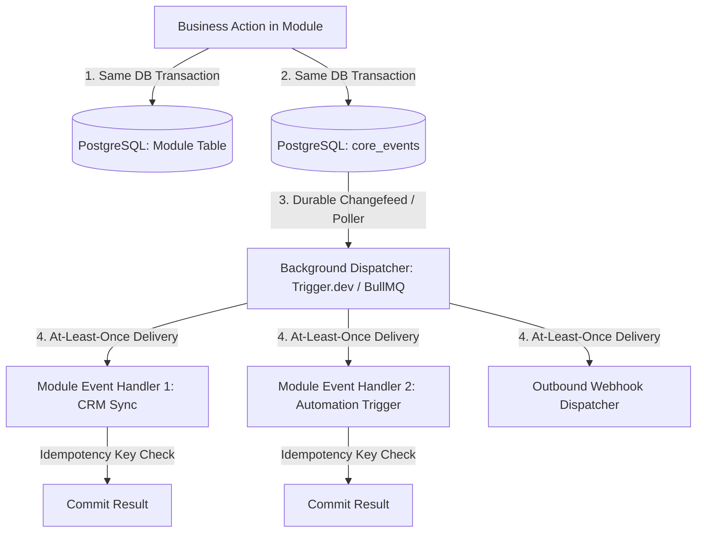
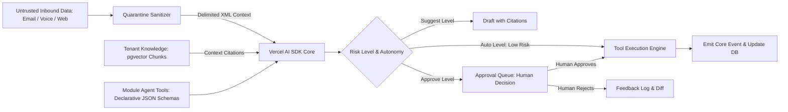
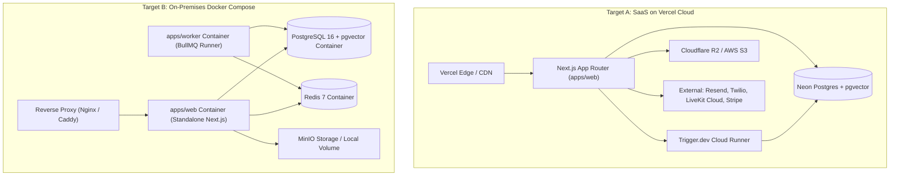

# System Architecture Specification

Modular, White-Label Business Operating System

---

## 1. Architectural Philosophy and Design Principles

The platform is designed as an **extensible modular monolith** with a **manifest-driven plugin system** and a **decoupled white-label presentation shell**. It delivers enterprise-grade ERP, CRM, and communication capabilities with the deployment agility of a single deployable unit.

### Core Design Principles
1. **Manifest-Driven Modularity:** Every business capability (Mail, Voice, CRM, Inventory, Invoicing, Knowledge, Automations) is an independent module exporting a single typed manifest (`ModuleManifest`). The host application discovers and mounts modules dynamically at runtime.
2. **Zero Direct Module Cross-Imports:** Modules never import from one another. Communication occurs exclusively via:
   - Typed asynchronous events on the transactional event bus.
   - Core shared entities (`core_contacts`, `core_files`, `core_users`).
   - Declared optional integrations resolved at runtime by the core kernel.
3. **Defense-in-Depth Multi-Tenancy:** Isolation is enforced at the database kernel level using PostgreSQL Row Level Security (RLS) policies, corroborated by application-layer filters in the data access layer.
4. **First-Class Supervised AI Runtime:** AI agents operate under scoped service identities, bounded autonomy levels (`suggest`, `approve`, `auto`), a centralized approval queue, untrusted data quarantine, and continuous CI regression evaluation.
5. **Rebrand in Under a Day:** All visual tokens, branding assets, document templates, email shells, and default personas reside in declarative brand packs (`packages/brand/*`) and runtime tenant settings. Zero customer-specific names or assets exist in application code.

---

## 2. Monorepo Layered Architecture

```
                                  ┌────────────────────────┐
                                  │   apps/web (Next.js)   │
                                  │   UI Shell, Host & API │
                                  └───────────┬────────────┘
                                              │
                    ┌─────────────────────────┴─────────────────────────┐
                    ▼                                                   ▼
         ┌─────────────────────┐                             ┌─────────────────────┐
         │     packages/ui     │                             │    packages/core    │
         │  shadcn/ui & Tokens │                             │  Tenancy, RBAC, Bus │
         └──────────┬──────────┘                             └──────────┬──────────┘
                    │                                                   │
     ┌──────────────┴──────────────┐                     ┌──────────────┴──────────────┐
     ▼                             ▼                     ▼                             ▼
┌──────────────┐            ┌──────────────┐      ┌──────────────┐              ┌──────────────┐
│packages/brand│            │ packages/    │      │packages/     │              │  packages/   │
│ Customer Pack│            │ modules/*    │      │agent-kit     │              │  providers/* │
└──────────────┘            └──────────────┘      └──────────────┘              └──────────────┘
                                   │
                                   ▼
                      ┌──────────────────────────┐
                      │   apps/worker (Node)     │
                      │  Self-Hosted Job Runner  │
                      └──────────────────────────┘
```

### Directory Roles
- **`apps/web`**: Next.js 15 App Router application serving as the web shell, dashboard layout, dynamic route host, and API gateway.
- **`apps/worker`**: Standalone Node.js process used in Docker/self-hosted environments for executing background jobs (BullMQ), event dispatching, and LiveKit voice agent workers.
- **`packages/core`**: The kernel governing tenant resolution, session management, RLS transaction initialization, RBAC enforcement, event outbox dispatching, audit logging, entitlements verification, and outbound webhooks.
- **`packages/ui`**: Component library containing accessible Radix UI primitives styled with Tailwind CSS, design token variables, TanStack Table views, xyflow canvas wrappers, and TipTap editors.
- **`packages/agent-kit`**: Agent runtime handling LLM provider routing (Vercel AI SDK), tool resolution, untrusted prompt injection sanitization, approval queue workflows, pgvector retrieval, and tracing.
- **`packages/providers/*`**: Decoupled infrastructure adapters implementing typed interfaces for Gmail, Microsoft Graph, IMAP, Twilio, LiveKit, Resend, Amazon SES, Stripe, and S3 storage.
- **`packages/modules/*`**: Self-contained business modules (Mail, Voice, CRM, Inventory, Invoicing, Knowledge, Automations).
- **`packages/brand/*`**: Customer brand packs defining logos, colors, fonts, default copy, personas, and document templates.

---

## 3. End-to-End Request Lifecycle



---

## 4. Multi-Tenancy and Database Isolation

### 4.1 Row Level Security (RLS) Engine
Every relational table (excluding the root `core_tenants` catalog) includes `tenant_id UUID NOT NULL REFERENCES core_tenants(id) ON DELETE CASCADE`.

On every database connection acquired by the application or worker:
```sql
SET LOCAL app.current_tenant_id = '018f45a2-3b21-7000-8000-123456789abc';
```

All table schemas define an engine-level security policy:
```sql
ALTER TABLE <table_name> ENABLE ROW LEVEL SECURITY;
ALTER TABLE <table_name> FORCE ROW LEVEL SECURITY;

CREATE POLICY tenant_isolation_policy ON <table_name>
  AS RESTRICTIVE
  USING (tenant_id = NULLIF(current_setting('app.current_tenant_id', true), '')::uuid)
  WITH CHECK (tenant_id = NULLIF(current_setting('app.current_tenant_id', true), '')::uuid);
```

### 4.2 Application Layer Defense-in-Depth
In addition to PostgreSQL RLS, the Drizzle ORM client wraps all data operations in a scoped context:
```typescript
export function createTenantDb(tenantId: string) {
  return drizzleClient.$with({
    // Automatically appends eq(table.tenantId, tenantId) to every query
  });
}
```

---

## 5. Manifest-Driven Module Subsystem

### 5.1 Module Lifecycle State Machine



### 5.2 Dynamic Manifest Loading
At application startup, `@repo/core` scans and registers manifests from all installed module packages. 
- **Routes & Navigation:** The host layout queries active modules for the current tenant and dynamically constructs the navigation sidebar and command palette index.
- **API Routing:** Next.js dynamic catch-all route (`/api/modules/[module]/[...path]`) maps incoming requests to the registered module's typed API handlers.
- **Event Subscriptions:** The event dispatcher registers handler functions defined in `manifest.events.handles`.
- **Agent Tools:** The agent runtime populates its tool registry with actions declared in `manifest.agentTools`.

---

## 6. Event Bus and Background Work

### 6.1 Transactional Outbox Event Flow



### 6.2 Job Engine Abstraction
Jobs (batch campaigns, inventory valuation, sync cycles) run via a unified `JobProvider` interface:
- **Cloud Target:** Trigger.dev v3 executes tasks with checkpointed step durability and zero serverless timeouts.
- **Self-Hosted Target:** BullMQ runner in `apps/worker` processes Redis-backed queues.

---

## 7. AI Agent Framework and Guardrails



### 7.1 Autonomy & Risk Matrix
| Risk Level | Typical Actions | Default Autonomy | Approver Required |
|---|---|---|---|
| **Read** | `checkStock`, `getInvoiceStatus`, `searchContacts` | `auto` | None |
| **Write** | `createDeal`, `updateContactTag`, `saveDraft` | `suggest` or `auto` | User configured |
| **External Send** | `sendEmailReply`, `dispatchSMS` | `approve` | Manager / Agent |
| **Financial** | `refundPayment`, `writeOffStock`, `issueCreditNote` | `approve` | Manager / Owner |

### 7.2 Prompt Injection Defense
1. **XML Isolation:** External inputs are enclosed in `<untrusted_content source="email">...</untrusted_content>`.
2. **Instruction Neutralization:** System prompts instruct models that untrusted content cannot issue commands or alter tool permissions.
3. **Structured Validation:** Model responses must parse through strict Zod schemas. Free-form text cannot trigger tool arguments directly.
4. **Adversarial CI Testing:** 50 automated injection attack scenarios test the agent pipeline on every code change.

---

## 8. Provider Abstraction Architecture

Provider packages wrap third-party APIs behind strictly typed interfaces:
- **`InboxProvider`**: Gmail API, Microsoft Graph, generic IMAP.
- **`BulkSendProvider`**: Resend, Amazon SES, generic SMTP.
- **`TelephonyProvider`**: Twilio Voice, Telnyx.
- **`VoicePipelineProvider`**: LiveKit Agents framework (STT via Deepgram, TTS via Cartesia/ElevenLabs).
- **`StorageProvider`**: AWS S3 / Cloudflare R2, Local Filesystem.
- **`BillingProvider`**: Stripe Billing & Customer Portal.

---

## 9. Deployment Topologies



---

## 10. Observability, Audit, and Telemetry

1. **Immutable Audit Trail:** All database updates, agent actions, and authorization changes append to `core_audit_log` with before/after state diffs.
2. **Agent Run Tracing:** Every inference call writes to `agent_runs` logging prompt versions, tokens, latency, cost in cents, and source citations.
3. **Structured Logging:** Standard JSON logging with correlation IDs (`traceId`) propagated through HTTP headers, database transactions, background jobs, and outbound webhooks.
4. **Health Endpoints:**
   - `/api/health/live`: Basic liveness probe.
   - `/api/health/ready`: Readiness probe verifying database connectivity, storage access, and job worker responsiveness.
