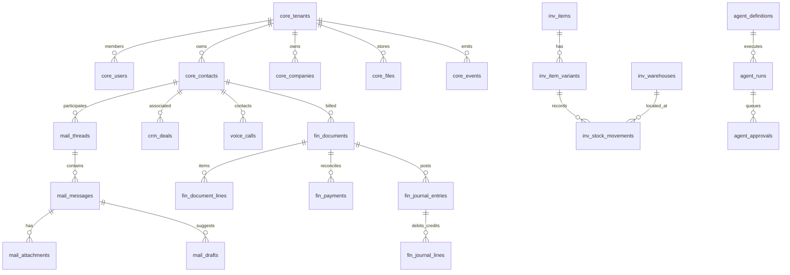

# Platform Data Model & Schema Specification

Multi-Tenant Relational Schema, Vector Storage, and Append-Only Ledgers

---

## 1. Schema Conventions & Global Standards

1. **Primary Keys:** Every table uses `id UUID PRIMARY KEY DEFAULT gen_random_uuid()`.
2. **Multi-Tenancy:** Every table except `core_tenants` includes `tenant_id UUID NOT NULL REFERENCES core_tenants(id) ON DELETE CASCADE`.
3. **Audit Timestamps:** Every table contains `created_at TIMESTAMPTZ NOT NULL DEFAULT now()` and `updated_at TIMESTAMPTZ NOT NULL DEFAULT now()`.
4. **Table Prefixing:**
   - Kernel tables: `core_`
   - Mail: `mail_`
   - Voice: `voice_`
   - CRM: `crm_`
   - Inventory: `inv_`
   - Invoicing & Finance: `fin_`
   - Knowledge & RAG: `kb_`
   - Automations: `auto_`
   - Agent Kit: `agent_`
5. **Monetary Quantities:** Stored as integer minor units (e.g. `$100.50` = `10050` cents) with an explicit 3-letter ISO-4217 currency code (e.g., `USD`, `EUR`, `ETB`). Floating-point arithmetic on money is strictly forbidden.
6. **Stock Balances:** Stored exclusively as an **append-only ledger** (`inv_stock_movements`). On-hand quantities are dynamically aggregated via SQL or cached materialized projections.

---

## 2. Entity-Relationship Overview



---

## 3. Core Kernel Schemas (`packages/core`)

### 3.1 `core_tenants`
Root workspace entity.
```sql
CREATE TABLE core_tenants (
  id UUID PRIMARY KEY DEFAULT gen_random_uuid(),
  name TEXT NOT NULL,
  slug TEXT NOT NULL UNIQUE,
  domain TEXT UNIQUE,
  plan_id TEXT NOT NULL DEFAULT 'starter',
  brand_pack_id TEXT NOT NULL DEFAULT 'default',
  status TEXT NOT NULL DEFAULT 'active' CHECK (status IN ('active', 'suspended', 'trial', 'past_due')),
  trial_ends_at TIMESTAMPTZ,
  settings JSONB NOT NULL DEFAULT '{}'::jsonb,
  created_at TIMESTAMPTZ NOT NULL DEFAULT now(),
  updated_at TIMESTAMPTZ NOT NULL DEFAULT now()
);
```

### 3.2 `core_users`
User identities across workspaces.
```sql
CREATE TABLE core_users (
  id UUID PRIMARY KEY DEFAULT gen_random_uuid(),
  tenant_id UUID NOT NULL REFERENCES core_tenants(id) ON DELETE CASCADE,
  email TEXT NOT NULL,
  name TEXT NOT NULL,
  avatar_url TEXT,
  role_id UUID NOT NULL REFERENCES core_roles(id),
  status TEXT NOT NULL DEFAULT 'active' CHECK (status IN ('active', 'invited', 'suspended')),
  preferences JSONB NOT NULL DEFAULT '{}'::jsonb,
  last_login_at TIMESTAMPTZ,
  created_at TIMESTAMPTZ NOT NULL DEFAULT now(),
  updated_at TIMESTAMPTZ NOT NULL DEFAULT now(),
  CONSTRAINT uq_tenant_email UNIQUE(tenant_id, email)
);
```

### 3.3 `core_roles` & `core_permissions`
Role definitions and permission assignments.
```sql
CREATE TABLE core_roles (
  id UUID PRIMARY KEY DEFAULT gen_random_uuid(),
  tenant_id UUID NOT NULL REFERENCES core_tenants(id) ON DELETE CASCADE,
  name TEXT NOT NULL,
  is_system BOOLEAN NOT NULL DEFAULT false,
  permissions TEXT[] NOT NULL DEFAULT '{}',
  created_at TIMESTAMPTZ NOT NULL DEFAULT now(),
  updated_at TIMESTAMPTZ NOT NULL DEFAULT now()
);
```

### 3.4 `core_contacts` & `core_companies`
Universal shared customer and business directories.
```sql
CREATE TABLE core_companies (
  id UUID PRIMARY KEY DEFAULT gen_random_uuid(),
  tenant_id UUID NOT NULL REFERENCES core_tenants(id) ON DELETE CASCADE,
  name TEXT NOT NULL,
  domain TEXT,
  industry TEXT,
  size TEXT,
  address JSONB NOT NULL DEFAULT '{}'::jsonb,
  custom_fields JSONB NOT NULL DEFAULT '{}'::jsonb,
  created_at TIMESTAMPTZ NOT NULL DEFAULT now(),
  updated_at TIMESTAMPTZ NOT NULL DEFAULT now()
);

CREATE TABLE core_contacts (
  id UUID PRIMARY KEY DEFAULT gen_random_uuid(),
  tenant_id UUID NOT NULL REFERENCES core_tenants(id) ON DELETE CASCADE,
  company_id UUID REFERENCES core_companies(id) ON DELETE SET NULL,
  first_name TEXT NOT NULL,
  last_name TEXT,
  email TEXT,
  phone TEXT,
  avatar_url TEXT,
  source TEXT DEFAULT 'manual',
  tags TEXT[] NOT NULL DEFAULT '{}',
  do_not_contact BOOLEAN NOT NULL DEFAULT false,
  custom_fields JSONB NOT NULL DEFAULT '{}'::jsonb,
  created_at TIMESTAMPTZ NOT NULL DEFAULT now(),
  updated_at TIMESTAMPTZ NOT NULL DEFAULT now()
);
```

### 3.5 `core_files`
Unified metadata registry for files stored in S3/MinIO.
```sql
CREATE TABLE core_files (
  id UUID PRIMARY KEY DEFAULT gen_random_uuid(),
  tenant_id UUID NOT NULL REFERENCES core_tenants(id) ON DELETE CASCADE,
  name TEXT NOT NULL,
  mime_type TEXT NOT NULL,
  size_bytes BIGINT NOT NULL,
  storage_provider TEXT NOT NULL DEFAULT 's3',
  storage_key TEXT NOT NULL,
  uploaded_by UUID REFERENCES core_users(id) ON DELETE SET NULL,
  created_at TIMESTAMPTZ NOT NULL DEFAULT now()
);
```

### 3.6 `core_events` (Transactional Outbox)
Durable event bus storage.
```sql
CREATE TABLE core_events (
  id UUID PRIMARY KEY DEFAULT gen_random_uuid(),
  tenant_id UUID NOT NULL REFERENCES core_tenants(id) ON DELETE CASCADE,
  type TEXT NOT NULL,
  payload JSONB NOT NULL,
  metadata JSONB NOT NULL DEFAULT '{}'::jsonb,
  idempotency_key TEXT NOT NULL,
  status TEXT NOT NULL DEFAULT 'pending' CHECK (status IN ('pending', 'processing', 'completed', 'failed', 'dead')),
  attempts INT NOT NULL DEFAULT 0,
  last_error TEXT,
  created_at TIMESTAMPTZ NOT NULL DEFAULT now(),
  processed_at TIMESTAMPTZ,
  CONSTRAINT uq_tenant_idempotency UNIQUE(tenant_id, idempotency_key)
);
```

### 3.7 `core_audit_log`
Immutable record of all state transitions.
```sql
CREATE TABLE core_audit_log (
  id UUID PRIMARY KEY DEFAULT gen_random_uuid(),
  tenant_id UUID NOT NULL REFERENCES core_tenants(id) ON DELETE CASCADE,
  user_id UUID REFERENCES core_users(id) ON DELETE SET NULL,
  agent_id UUID,
  action TEXT NOT NULL,
  entity_type TEXT NOT NULL,
  entity_id UUID NOT NULL,
  before_state JSONB,
  after_state JSONB,
  ip_address TEXT,
  user_agent TEXT,
  created_at TIMESTAMPTZ NOT NULL DEFAULT now()
);
```

### 3.8 `core_secrets`
Envelope encryption store for third-party OAuth tokens and API keys.
```sql
CREATE TABLE core_secrets (
  id UUID PRIMARY KEY DEFAULT gen_random_uuid(),
  tenant_id UUID NOT NULL REFERENCES core_tenants(id) ON DELETE CASCADE,
  provider TEXT NOT NULL,
  encrypted_data BYTEA NOT NULL,
  iv BYTEA NOT NULL,
  key_version INT NOT NULL DEFAULT 1,
  created_at TIMESTAMPTZ NOT NULL DEFAULT now(),
  updated_at TIMESTAMPTZ NOT NULL DEFAULT now()
);
```

---

## 4. Mail Module Schemas (`packages/modules/mail`)

### 4.1 Accounts, Threads, and Messages
```sql
CREATE TABLE mail_accounts (
  id UUID PRIMARY KEY DEFAULT gen_random_uuid(),
  tenant_id UUID NOT NULL REFERENCES core_tenants(id) ON DELETE CASCADE,
  provider TEXT NOT NULL CHECK (provider IN ('gmail', 'graph', 'imap')),
  email_address TEXT NOT NULL,
  display_name TEXT,
  secret_id UUID NOT NULL REFERENCES core_secrets(id),
  sync_state JSONB NOT NULL DEFAULT '{}'::jsonb,
  status TEXT NOT NULL DEFAULT 'active' CHECK (status IN ('active', 'error', 'syncing')),
  is_shared BOOLEAN NOT NULL DEFAULT false,
  last_sync_at TIMESTAMPTZ,
  created_at TIMESTAMPTZ NOT NULL DEFAULT now(),
  updated_at TIMESTAMPTZ NOT NULL DEFAULT now()
);

CREATE TABLE mail_threads (
  id UUID PRIMARY KEY DEFAULT gen_random_uuid(),
  tenant_id UUID NOT NULL REFERENCES core_tenants(id) ON DELETE CASCADE,
  account_id UUID NOT NULL REFERENCES mail_accounts(id) ON DELETE CASCADE,
  provider_thread_id TEXT NOT NULL,
  contact_id UUID REFERENCES core_contacts(id) ON DELETE SET NULL,
  subject TEXT NOT NULL,
  snippet TEXT,
  category TEXT DEFAULT 'other' CHECK (category IN ('support', 'sales', 'billing', 'partnership', 'meeting', 'spam', 'promo', 'other')),
  priority TEXT DEFAULT 'medium' CHECK (priority IN ('urgent', 'high', 'medium', 'low')),
  status TEXT NOT NULL DEFAULT 'open' CHECK (status IN ('open', 'snoozed', 'done', 'archived')),
  assigned_to UUID REFERENCES core_users(id) ON DELETE SET NULL,
  snoozed_until TIMESTAMPTZ,
  labels TEXT[] NOT NULL DEFAULT '{}',
  message_count INT NOT NULL DEFAULT 1,
  last_message_at TIMESTAMPTZ NOT NULL DEFAULT now(),
  created_at TIMESTAMPTZ NOT NULL DEFAULT now(),
  updated_at TIMESTAMPTZ NOT NULL DEFAULT now()
);

CREATE TABLE mail_messages (
  id UUID PRIMARY KEY DEFAULT gen_random_uuid(),
  tenant_id UUID NOT NULL REFERENCES core_tenants(id) ON DELETE CASCADE,
  thread_id UUID NOT NULL REFERENCES mail_threads(id) ON DELETE CASCADE,
  account_id UUID NOT NULL REFERENCES mail_accounts(id) ON DELETE CASCADE,
  provider_message_id TEXT NOT NULL,
  from_address TEXT NOT NULL,
  to_addresses TEXT[] NOT NULL DEFAULT '{}',
  cc_addresses TEXT[] NOT NULL DEFAULT '{}',
  bcc_addresses TEXT[] NOT NULL DEFAULT '{}',
  subject TEXT NOT NULL,
  body_html TEXT NOT NULL,
  body_text TEXT NOT NULL,
  snippet TEXT,
  direction TEXT NOT NULL CHECK (direction IN ('inbound', 'outbound')),
  status TEXT NOT NULL DEFAULT 'received' CHECK (status IN ('received', 'draft', 'queued', 'sent', 'failed', 'bounced')),
  headers JSONB NOT NULL DEFAULT '{}'::jsonb,
  has_attachments BOOLEAN NOT NULL DEFAULT false,
  sent_at TIMESTAMPTZ,
  created_at TIMESTAMPTZ NOT NULL DEFAULT now()
);

CREATE TABLE mail_drafts (
  id UUID PRIMARY KEY DEFAULT gen_random_uuid(),
  tenant_id UUID NOT NULL REFERENCES core_tenants(id) ON DELETE CASCADE,
  thread_id UUID NOT NULL REFERENCES mail_threads(id) ON DELETE CASCADE,
  agent_id UUID,
  body_html TEXT NOT NULL,
  body_text TEXT NOT NULL,
  confidence_score NUMERIC(3, 2),
  sources_used JSONB NOT NULL DEFAULT '[]'::jsonb,
  status TEXT NOT NULL DEFAULT 'draft' CHECK (status IN ('draft', 'approved', 'rejected', 'sent')),
  approved_by UUID REFERENCES core_users(id) ON DELETE SET NULL,
  created_at TIMESTAMPTZ NOT NULL DEFAULT now(),
  updated_at TIMESTAMPTZ NOT NULL DEFAULT now()
);
```

### 4.2 Audiences, Campaigns, and Deliverability
```sql
CREATE TABLE mail_audiences (
  id UUID PRIMARY KEY DEFAULT gen_random_uuid(),
  tenant_id UUID NOT NULL REFERENCES core_tenants(id) ON DELETE CASCADE,
  name TEXT NOT NULL,
  description TEXT,
  type TEXT NOT NULL CHECK (type IN ('static', 'crm_segment')),
  filter_definition JSONB DEFAULT '{}'::jsonb,
  contact_count INT NOT NULL DEFAULT 0,
  created_at TIMESTAMPTZ NOT NULL DEFAULT now(),
  updated_at TIMESTAMPTZ NOT NULL DEFAULT now()
);

CREATE TABLE mail_audience_members (
  id UUID PRIMARY KEY DEFAULT gen_random_uuid(),
  audience_id UUID NOT NULL REFERENCES mail_audiences(id) ON DELETE CASCADE,
  tenant_id UUID NOT NULL REFERENCES core_tenants(id) ON DELETE CASCADE,
  email TEXT NOT NULL,
  data JSONB NOT NULL DEFAULT '{}'::jsonb,
  created_at TIMESTAMPTZ NOT NULL DEFAULT now()
);

CREATE TABLE mail_campaigns (
  id UUID PRIMARY KEY DEFAULT gen_random_uuid(),
  tenant_id UUID NOT NULL REFERENCES core_tenants(id) ON DELETE CASCADE,
  name TEXT NOT NULL,
  audience_id UUID NOT NULL REFERENCES mail_audiences(id),
  from_account_id UUID NOT NULL REFERENCES mail_accounts(id),
  subject_a TEXT NOT NULL,
  subject_b TEXT,
  body_html TEXT NOT NULL,
  body_text TEXT NOT NULL,
  status TEXT NOT NULL DEFAULT 'draft' CHECK (status IN ('draft', 'scheduled', 'sending', 'paused', 'completed', 'failed')),
  throttle_per_minute INT NOT NULL DEFAULT 60,
  total_recipients INT NOT NULL DEFAULT 0,
  sent_count INT NOT NULL DEFAULT 0,
  opened_count INT NOT NULL DEFAULT 0,
  clicked_count INT NOT NULL DEFAULT 0,
  bounced_count INT NOT NULL DEFAULT 0,
  complained_count INT NOT NULL DEFAULT 0,
  scheduled_at TIMESTAMPTZ,
  started_at TIMESTAMPTZ,
  completed_at TIMESTAMPTZ,
  resume_cursor INT NOT NULL DEFAULT 0,
  created_at TIMESTAMPTZ NOT NULL DEFAULT now(),
  updated_at TIMESTAMPTZ NOT NULL DEFAULT now()
);

CREATE TABLE mail_suppressions (
  id UUID PRIMARY KEY DEFAULT gen_random_uuid(),
  tenant_id UUID NOT NULL REFERENCES core_tenants(id) ON DELETE CASCADE,
  email TEXT NOT NULL,
  reason TEXT NOT NULL CHECK (reason IN ('bounce', 'complaint', 'unsubscribe', 'manual')),
  created_at TIMESTAMPTZ NOT NULL DEFAULT now(),
  CONSTRAINT uq_tenant_suppressed_email UNIQUE(tenant_id, email)
);
```

---

## 5. Voice Module Schemas (`packages/modules/voice`)

```sql
CREATE TABLE voice_phone_numbers (
  id UUID PRIMARY KEY DEFAULT gen_random_uuid(),
  tenant_id UUID NOT NULL REFERENCES core_tenants(id) ON DELETE CASCADE,
  phone_number TEXT NOT NULL,
  provider TEXT NOT NULL CHECK (provider IN ('twilio', 'telnyx')),
  provider_sid TEXT NOT NULL,
  capabilities TEXT[] NOT NULL DEFAULT '{"voice"}',
  assigned_flow_id UUID,
  created_at TIMESTAMPTZ NOT NULL DEFAULT now()
);

CREATE TABLE voice_call_flows (
  id UUID PRIMARY KEY DEFAULT gen_random_uuid(),
  tenant_id UUID NOT NULL REFERENCES core_tenants(id) ON DELETE CASCADE,
  name TEXT NOT NULL,
  description TEXT,
  flow_graph JSONB NOT NULL DEFAULT '{}'::jsonb,
  greeting_text TEXT NOT NULL,
  business_hours JSONB NOT NULL DEFAULT '{}'::jsonb,
  fallback_action TEXT NOT NULL DEFAULT 'voicemail',
  is_active BOOLEAN NOT NULL DEFAULT true,
  created_at TIMESTAMPTZ NOT NULL DEFAULT now(),
  updated_at TIMESTAMPTZ NOT NULL DEFAULT now()
);

CREATE TABLE voice_calls (
  id UUID PRIMARY KEY DEFAULT gen_random_uuid(),
  tenant_id UUID NOT NULL REFERENCES core_tenants(id) ON DELETE CASCADE,
  phone_number_id UUID REFERENCES voice_phone_numbers(id) ON DELETE SET NULL,
  flow_id UUID REFERENCES voice_call_flows(id) ON DELETE SET NULL,
  provider_call_sid TEXT NOT NULL,
  direction TEXT NOT NULL CHECK (direction IN ('inbound', 'outbound')),
  from_number TEXT NOT NULL,
  to_number TEXT NOT NULL,
  contact_id UUID REFERENCES core_contacts(id) ON DELETE SET NULL,
  status TEXT NOT NULL DEFAULT 'ringing' CHECK (status IN ('ringing', 'in_progress', 'completed', 'failed', 'busy', 'no_answer', 'voicemail')),
  duration_seconds INT NOT NULL DEFAULT 0,
  recording_file_id UUID REFERENCES core_files(id) ON DELETE SET NULL,
  transcript TEXT,
  transcript_segments JSONB NOT NULL DEFAULT '[]'::jsonb,
  summary TEXT,
  sentiment TEXT CHECK (sentiment IN ('positive', 'neutral', 'negative')),
  outcome_tags TEXT[] NOT NULL DEFAULT '{}',
  cost_cents INT NOT NULL DEFAULT 0,
  ai_contained BOOLEAN NOT NULL DEFAULT true,
  started_at TIMESTAMPTZ,
  ended_at TIMESTAMPTZ,
  created_at TIMESTAMPTZ NOT NULL DEFAULT now()
);

CREATE TABLE voice_compliance_config (
  id UUID PRIMARY KEY DEFAULT gen_random_uuid(),
  tenant_id UUID NOT NULL REFERENCES core_tenants(id) ON DELETE CASCADE,
  region TEXT NOT NULL,
  calling_hours_start TIME NOT NULL DEFAULT '08:00:00',
  calling_hours_end TIME NOT NULL DEFAULT '20:00:00',
  ai_disclosure_required BOOLEAN NOT NULL DEFAULT true,
  ai_disclosure_text TEXT NOT NULL,
  recording_disclosure_required BOOLEAN NOT NULL DEFAULT true,
  dnc_list_enabled BOOLEAN NOT NULL DEFAULT true,
  created_at TIMESTAMPTZ NOT NULL DEFAULT now(),
  updated_at TIMESTAMPTZ NOT NULL DEFAULT now()
);
```

---

## 6. CRM Module Schemas (`packages/modules/crm`)

```sql
CREATE TABLE crm_pipelines (
  id UUID PRIMARY KEY DEFAULT gen_random_uuid(),
  tenant_id UUID NOT NULL REFERENCES core_tenants(id) ON DELETE CASCADE,
  name TEXT NOT NULL,
  stages JSONB NOT NULL DEFAULT '[]'::jsonb,
  is_default BOOLEAN NOT NULL DEFAULT false,
  created_at TIMESTAMPTZ NOT NULL DEFAULT now(),
  updated_at TIMESTAMPTZ NOT NULL DEFAULT now()
);

CREATE TABLE crm_deals (
  id UUID PRIMARY KEY DEFAULT gen_random_uuid(),
  tenant_id UUID NOT NULL REFERENCES core_tenants(id) ON DELETE CASCADE,
  pipeline_id UUID NOT NULL REFERENCES crm_pipelines(id),
  stage_id TEXT NOT NULL,
  contact_id UUID REFERENCES core_contacts(id) ON DELETE SET NULL,
  company_id UUID REFERENCES core_companies(id) ON DELETE SET NULL,
  name TEXT NOT NULL,
  value_cents BIGINT NOT NULL DEFAULT 0,
  currency TEXT NOT NULL DEFAULT 'USD',
  probability INT NOT NULL DEFAULT 50,
  assigned_to UUID REFERENCES core_users(id) ON DELETE SET NULL,
  expected_close_date DATE,
  closed_at TIMESTAMPTZ,
  is_won BOOLEAN,
  lost_reason TEXT,
  tags TEXT[] NOT NULL DEFAULT '{}',
  custom_fields JSONB NOT NULL DEFAULT '{}'::jsonb,
  created_at TIMESTAMPTZ NOT NULL DEFAULT now(),
  updated_at TIMESTAMPTZ NOT NULL DEFAULT now()
);

CREATE TABLE crm_activities (
  id UUID PRIMARY KEY DEFAULT gen_random_uuid(),
  tenant_id UUID NOT NULL REFERENCES core_tenants(id) ON DELETE CASCADE,
  contact_id UUID REFERENCES core_contacts(id) ON DELETE CASCADE,
  deal_id UUID REFERENCES crm_deals(id) ON DELETE CASCADE,
  type TEXT NOT NULL CHECK (type IN ('note', 'email', 'call', 'meeting', 'task')),
  subject TEXT NOT NULL,
  body TEXT,
  metadata JSONB NOT NULL DEFAULT '{}'::jsonb,
  due_at TIMESTAMPTZ,
  completed_at TIMESTAMPTZ,
  created_at TIMESTAMPTZ NOT NULL DEFAULT now()
);
```

---

## 7. Inventory Module Schemas (`packages/modules/inventory`)

### 7.1 Append-Only Movement Ledger
All inventory balances are calculated by aggregating `inv_stock_movements`. Quantities are signed integers (positive for arrivals, negative for dispatches).
```sql
CREATE TABLE inv_items (
  id UUID PRIMARY KEY DEFAULT gen_random_uuid(),
  tenant_id UUID NOT NULL REFERENCES core_tenants(id) ON DELETE CASCADE,
  sku TEXT NOT NULL,
  name TEXT NOT NULL,
  description TEXT,
  category TEXT,
  unit_of_measure TEXT NOT NULL DEFAULT 'pcs',
  track_inventory BOOLEAN NOT NULL DEFAULT true,
  has_variants BOOLEAN NOT NULL DEFAULT false,
  costing_method TEXT NOT NULL DEFAULT 'average' CHECK (costing_method IN ('fifo', 'average')),
  reorder_point INT NOT NULL DEFAULT 0,
  reorder_quantity INT NOT NULL DEFAULT 0,
  image_file_id UUID REFERENCES core_files(id) ON DELETE SET NULL,
  created_at TIMESTAMPTZ NOT NULL DEFAULT now(),
  updated_at TIMESTAMPTZ NOT NULL DEFAULT now(),
  CONSTRAINT uq_tenant_item_sku UNIQUE(tenant_id, sku)
);

CREATE TABLE inv_item_variants (
  id UUID PRIMARY KEY DEFAULT gen_random_uuid(),
  item_id UUID NOT NULL REFERENCES inv_items(id) ON DELETE CASCADE,
  tenant_id UUID NOT NULL REFERENCES core_tenants(id) ON DELETE CASCADE,
  sku TEXT NOT NULL,
  name TEXT NOT NULL,
  attributes JSONB NOT NULL DEFAULT '{}'::jsonb,
  barcode TEXT,
  cost_cents BIGINT NOT NULL DEFAULT 0,
  price_cents BIGINT NOT NULL DEFAULT 0,
  currency TEXT NOT NULL DEFAULT 'USD',
  created_at TIMESTAMPTZ NOT NULL DEFAULT now(),
  updated_at TIMESTAMPTZ NOT NULL DEFAULT now(),
  CONSTRAINT uq_tenant_variant_sku UNIQUE(tenant_id, sku)
);

CREATE TABLE inv_warehouses (
  id UUID PRIMARY KEY DEFAULT gen_random_uuid(),
  tenant_id UUID NOT NULL REFERENCES core_tenants(id) ON DELETE CASCADE,
  name TEXT NOT NULL,
  code TEXT NOT NULL,
  address JSONB NOT NULL DEFAULT '{}'::jsonb,
  is_default BOOLEAN NOT NULL DEFAULT false,
  created_at TIMESTAMPTZ NOT NULL DEFAULT now(),
  updated_at TIMESTAMPTZ NOT NULL DEFAULT now()
);

CREATE TABLE inv_bins (
  id UUID PRIMARY KEY DEFAULT gen_random_uuid(),
  warehouse_id UUID NOT NULL REFERENCES inv_warehouses(id) ON DELETE CASCADE,
  tenant_id UUID NOT NULL REFERENCES core_tenants(id) ON DELETE CASCADE,
  name TEXT NOT NULL,
  code TEXT NOT NULL,
  created_at TIMESTAMPTZ NOT NULL DEFAULT now()
);

-- THE APPEND-ONLY LEDGER
CREATE TABLE inv_stock_movements (
  id UUID PRIMARY KEY DEFAULT gen_random_uuid(),
  tenant_id UUID NOT NULL REFERENCES core_tenants(id) ON DELETE CASCADE,
  item_id UUID NOT NULL REFERENCES inv_items(id) ON DELETE RESTRICT,
  variant_id UUID REFERENCES inv_item_variants(id) ON DELETE RESTRICT,
  warehouse_id UUID NOT NULL REFERENCES inv_warehouses(id) ON DELETE RESTRICT,
  bin_id UUID REFERENCES inv_bins(id) ON DELETE SET NULL,
  type TEXT NOT NULL CHECK (type IN ('receive', 'ship', 'transfer', 'adjust', 'count', 'reserve', 'unreserve', 'return')),
  quantity INT NOT NULL, -- Positive for increase, negative for decrease
  reference_type TEXT CHECK (reference_type IN ('purchase_order', 'sales_order', 'transfer', 'adjustment', 'count')),
  reference_id UUID,
  lot_number TEXT,
  serial_number TEXT,
  unit_cost_cents BIGINT NOT NULL DEFAULT 0,
  currency TEXT NOT NULL DEFAULT 'USD',
  notes TEXT,
  created_by UUID REFERENCES core_users(id) ON DELETE SET NULL,
  created_at TIMESTAMPTZ NOT NULL DEFAULT now()
);
```

---

## 8. Invoicing & Finance Schemas (`packages/modules/invoicing`)

### 8.1 Documents and Double-Entry Ledger
```sql
CREATE TABLE fin_documents (
  id UUID PRIMARY KEY DEFAULT gen_random_uuid(),
  tenant_id UUID NOT NULL REFERENCES core_tenants(id) ON DELETE CASCADE,
  type TEXT NOT NULL CHECK (type IN ('invoice', 'credit_note', 'quote', 'sales_order', 'purchase_order')),
  number TEXT NOT NULL,
  contact_id UUID NOT NULL REFERENCES core_contacts(id) ON DELETE RESTRICT,
  company_id UUID REFERENCES core_companies(id) ON DELETE SET NULL,
  status TEXT NOT NULL DEFAULT 'draft' CHECK (status IN ('draft', 'sent', 'viewed', 'partially_paid', 'paid', 'overdue', 'void', 'cancelled')),
  currency TEXT NOT NULL DEFAULT 'USD',
  subtotal_cents BIGINT NOT NULL DEFAULT 0,
  tax_total_cents BIGINT NOT NULL DEFAULT 0,
  total_cents BIGINT NOT NULL DEFAULT 0,
  amount_due_cents BIGINT NOT NULL DEFAULT 0,
  due_date DATE NOT NULL,
  issued_date DATE NOT NULL DEFAULT CURRENT_DATE,
  pdf_file_id UUID REFERENCES core_files(id) ON DELETE SET NULL,
  created_at TIMESTAMPTZ NOT NULL DEFAULT now(),
  updated_at TIMESTAMPTZ NOT NULL DEFAULT now(),
  CONSTRAINT uq_tenant_doc_number UNIQUE(tenant_id, type, number)
);

CREATE TABLE fin_document_lines (
  id UUID PRIMARY KEY DEFAULT gen_random_uuid(),
  document_id UUID NOT NULL REFERENCES fin_documents(id) ON DELETE CASCADE,
  tenant_id UUID NOT NULL REFERENCES core_tenants(id) ON DELETE CASCADE,
  item_id UUID REFERENCES inv_items(id) ON DELETE SET NULL,
  description TEXT NOT NULL,
  quantity INT NOT NULL DEFAULT 1,
  unit_price_cents BIGINT NOT NULL DEFAULT 0,
  tax_rate_percent NUMERIC(5, 2) NOT NULL DEFAULT 0.00,
  line_total_cents BIGINT NOT NULL DEFAULT 0,
  sort_order INT NOT NULL DEFAULT 0
);

CREATE TABLE fin_payments (
  id UUID PRIMARY KEY DEFAULT gen_random_uuid(),
  tenant_id UUID NOT NULL REFERENCES core_tenants(id) ON DELETE CASCADE,
  document_id UUID NOT NULL REFERENCES fin_documents(id) ON DELETE CASCADE,
  amount_cents BIGINT NOT NULL,
  currency TEXT NOT NULL DEFAULT 'USD',
  method TEXT NOT NULL CHECK (method IN ('stripe', 'bank_transfer', 'cash', 'mobile_money', 'other')),
  provider_payment_id TEXT,
  reference TEXT,
  status TEXT NOT NULL DEFAULT 'completed' CHECK (status IN ('pending', 'completed', 'failed', 'refunded')),
  received_at TIMESTAMPTZ NOT NULL DEFAULT now(),
  created_at TIMESTAMPTZ NOT NULL DEFAULT now()
);

-- DOUBLE-ENTRY JOURNAL
CREATE TABLE fin_chart_of_accounts (
  id UUID PRIMARY KEY DEFAULT gen_random_uuid(),
  tenant_id UUID NOT NULL REFERENCES core_tenants(id) ON DELETE CASCADE,
  code TEXT NOT NULL,
  name TEXT NOT NULL,
  type TEXT NOT NULL CHECK (type IN ('asset', 'liability', 'equity', 'revenue', 'expense')),
  currency TEXT NOT NULL DEFAULT 'USD',
  is_system BOOLEAN NOT NULL DEFAULT false,
  created_at TIMESTAMPTZ NOT NULL DEFAULT now()
);

CREATE TABLE fin_journal_entries (
  id UUID PRIMARY KEY DEFAULT gen_random_uuid(),
  tenant_id UUID NOT NULL REFERENCES core_tenants(id) ON DELETE CASCADE,
  date DATE NOT NULL DEFAULT CURRENT_DATE,
  reference TEXT,
  description TEXT NOT NULL,
  document_id UUID REFERENCES fin_documents(id) ON DELETE SET NULL,
  posted_at TIMESTAMPTZ,
  created_at TIMESTAMPTZ NOT NULL DEFAULT now()
);

CREATE TABLE fin_journal_lines (
  id UUID PRIMARY KEY DEFAULT gen_random_uuid(),
  entry_id UUID NOT NULL REFERENCES fin_journal_entries(id) ON DELETE CASCADE,
  tenant_id UUID NOT NULL REFERENCES core_tenants(id) ON DELETE CASCADE,
  account_id UUID NOT NULL REFERENCES fin_chart_of_accounts(id) ON DELETE RESTRICT,
  debit_cents BIGINT NOT NULL DEFAULT 0,
  credit_cents BIGINT NOT NULL DEFAULT 0,
  currency TEXT NOT NULL DEFAULT 'USD',
  description TEXT
);
```

---

## 9. Knowledge & Vector RAG Schemas (`packages/modules/knowledge`)

```sql
CREATE EXTENSION IF NOT EXISTS vector;

CREATE TABLE kb_sources (
  id UUID PRIMARY KEY DEFAULT gen_random_uuid(),
  tenant_id UUID NOT NULL REFERENCES core_tenants(id) ON DELETE CASCADE,
  type TEXT NOT NULL CHECK (type IN ('document', 'url', 'text', 'faq')),
  name TEXT NOT NULL,
  url TEXT,
  file_id UUID REFERENCES core_files(id) ON DELETE SET NULL,
  status TEXT NOT NULL DEFAULT 'pending' CHECK (status IN ('pending', 'processing', 'indexed', 'failed')),
  chunk_count INT NOT NULL DEFAULT 0,
  last_indexed_at TIMESTAMPTZ,
  created_at TIMESTAMPTZ NOT NULL DEFAULT now(),
  updated_at TIMESTAMPTZ NOT NULL DEFAULT now()
);

CREATE TABLE kb_chunks (
  id UUID PRIMARY KEY DEFAULT gen_random_uuid(),
  source_id UUID NOT NULL REFERENCES kb_sources(id) ON DELETE CASCADE,
  tenant_id UUID NOT NULL REFERENCES core_tenants(id) ON DELETE CASCADE,
  content TEXT NOT NULL,
  embedding vector(1536) NOT NULL,
  metadata JSONB NOT NULL DEFAULT '{}'::jsonb,
  token_count INT NOT NULL DEFAULT 0,
  created_at TIMESTAMPTZ NOT NULL DEFAULT now()
);

CREATE TABLE kb_agent_memory (
  id UUID PRIMARY KEY DEFAULT gen_random_uuid(),
  tenant_id UUID NOT NULL REFERENCES core_tenants(id) ON DELETE CASCADE,
  contact_id UUID NOT NULL REFERENCES core_contacts(id) ON DELETE CASCADE,
  key TEXT NOT NULL,
  value TEXT NOT NULL,
  source TEXT NOT NULL DEFAULT 'agent_inferred',
  created_at TIMESTAMPTZ NOT NULL DEFAULT now(),
  updated_at TIMESTAMPTZ NOT NULL DEFAULT now()
);
```

---

## 10. Automations Schemas (`packages/modules/automations`)

```sql
CREATE TABLE auto_workflows (
  id UUID PRIMARY KEY DEFAULT gen_random_uuid(),
  tenant_id UUID NOT NULL REFERENCES core_tenants(id) ON DELETE CASCADE,
  name TEXT NOT NULL,
  description TEXT,
  trigger_definition JSONB NOT NULL,
  steps JSONB NOT NULL DEFAULT '[]'::jsonb,
  status TEXT NOT NULL DEFAULT 'active' CHECK (status IN ('active', 'paused', 'draft')),
  run_count INT NOT NULL DEFAULT 0,
  last_run_at TIMESTAMPTZ,
  created_at TIMESTAMPTZ NOT NULL DEFAULT now(),
  updated_at TIMESTAMPTZ NOT NULL DEFAULT now()
);

CREATE TABLE auto_workflow_runs (
  id UUID PRIMARY KEY DEFAULT gen_random_uuid(),
  workflow_id UUID NOT NULL REFERENCES auto_workflows(id) ON DELETE CASCADE,
  tenant_id UUID NOT NULL REFERENCES core_tenants(id) ON DELETE CASCADE,
  trigger_event_id UUID REFERENCES core_events(id) ON DELETE SET NULL,
  status TEXT NOT NULL DEFAULT 'running' CHECK (status IN ('running', 'completed', 'failed', 'cancelled')),
  started_at TIMESTAMPTZ NOT NULL DEFAULT now(),
  completed_at TIMESTAMPTZ,
  error TEXT
);

CREATE TABLE auto_workflow_step_logs (
  id UUID PRIMARY KEY DEFAULT gen_random_uuid(),
  run_id UUID NOT NULL REFERENCES auto_workflow_runs(id) ON DELETE CASCADE,
  tenant_id UUID NOT NULL REFERENCES core_tenants(id) ON DELETE CASCADE,
  step_index INT NOT NULL,
  step_type TEXT NOT NULL,
  input JSONB NOT NULL DEFAULT '{}'::jsonb,
  output JSONB NOT NULL DEFAULT '{}'::jsonb,
  status TEXT NOT NULL DEFAULT 'pending' CHECK (status IN ('pending', 'running', 'completed', 'failed', 'skipped')),
  error TEXT,
  started_at TIMESTAMPTZ NOT NULL DEFAULT now(),
  completed_at TIMESTAMPTZ
);
```

---

## 11. Agent Runtime Schemas (`packages/agent-kit`)

```sql
CREATE TABLE agent_definitions (
  id UUID PRIMARY KEY DEFAULT gen_random_uuid(),
  tenant_id UUID NOT NULL REFERENCES core_tenants(id) ON DELETE CASCADE,
  name TEXT NOT NULL,
  purpose TEXT NOT NULL,
  system_prompt TEXT NOT NULL,
  system_prompt_version INT NOT NULL DEFAULT 1,
  model TEXT NOT NULL DEFAULT 'claude-3-5-sonnet-latest',
  temperature NUMERIC(2, 1) NOT NULL DEFAULT 0.2,
  allowed_tools TEXT[] NOT NULL DEFAULT '{}',
  autonomy_rules JSONB NOT NULL DEFAULT '{}'::jsonb,
  budget_limits JSONB NOT NULL DEFAULT '{"max_cost_per_day_cents": 5000}'::jsonb,
  created_at TIMESTAMPTZ NOT NULL DEFAULT now(),
  updated_at TIMESTAMPTZ NOT NULL DEFAULT now()
);

CREATE TABLE agent_runs (
  id UUID PRIMARY KEY DEFAULT gen_random_uuid(),
  tenant_id UUID NOT NULL REFERENCES core_tenants(id) ON DELETE CASCADE,
  agent_id UUID NOT NULL REFERENCES agent_definitions(id) ON DELETE CASCADE,
  trigger_type TEXT NOT NULL CHECK (trigger_type IN ('event', 'manual', 'schedule')),
  status TEXT NOT NULL DEFAULT 'running' CHECK (status IN ('running', 'completed', 'failed', 'escalated')),
  inputs JSONB NOT NULL DEFAULT '{}'::jsonb,
  retrieved_sources JSONB NOT NULL DEFAULT '[]'::jsonb,
  tool_calls JSONB NOT NULL DEFAULT '[]'::jsonb,
  output JSONB,
  tokens_used INT NOT NULL DEFAULT 0,
  cost_cents INT NOT NULL DEFAULT 0,
  latency_ms INT NOT NULL DEFAULT 0,
  created_at TIMESTAMPTZ NOT NULL DEFAULT now(),
  completed_at TIMESTAMPTZ
);

CREATE TABLE agent_approvals (
  id UUID PRIMARY KEY DEFAULT gen_random_uuid(),
  tenant_id UUID NOT NULL REFERENCES core_tenants(id) ON DELETE CASCADE,
  agent_run_id UUID NOT NULL REFERENCES agent_runs(id) ON DELETE CASCADE,
  action_type TEXT NOT NULL,
  action_data JSONB NOT NULL,
  reasoning TEXT NOT NULL,
  sources_used JSONB NOT NULL DEFAULT '[]'::jsonb,
  risk_level TEXT NOT NULL CHECK (risk_level IN ('read', 'write', 'external-send', 'financial')),
  status TEXT NOT NULL DEFAULT 'pending' CHECK (status IN ('pending', 'approved', 'rejected', 'edited')),
  approved_by UUID REFERENCES core_users(id) ON DELETE SET NULL,
  human_edits JSONB,
  created_at TIMESTAMPTZ NOT NULL DEFAULT now()
);
```

---

## 12. Indexing Strategy & Performance

```sql
-- Multi-Tenancy Composite Indexes
CREATE INDEX idx_contacts_tenant_email ON core_contacts (tenant_id, email);
CREATE INDEX idx_threads_tenant_status ON mail_threads (tenant_id, status, last_message_at DESC);
CREATE INDEX idx_messages_thread ON mail_messages (tenant_id, thread_id, created_at ASC);
CREATE INDEX idx_events_pending ON core_events (tenant_id, status, created_at ASC) WHERE status = 'pending';

-- Inventory Movement Calculation Index
CREATE INDEX idx_stock_movements_calc ON inv_stock_movements (tenant_id, item_id, variant_id, warehouse_id);

-- Document Invoicing Indexes
CREATE INDEX idx_docs_tenant_type_status ON fin_documents (tenant_id, type, status, due_date);

-- HNSW Vector Retrieval Index for RAG
CREATE INDEX idx_kb_chunks_vector ON kb_chunks USING hnsw (embedding vector_cosine_ops) WITH (m = 16, ef_construction = 64);
```
