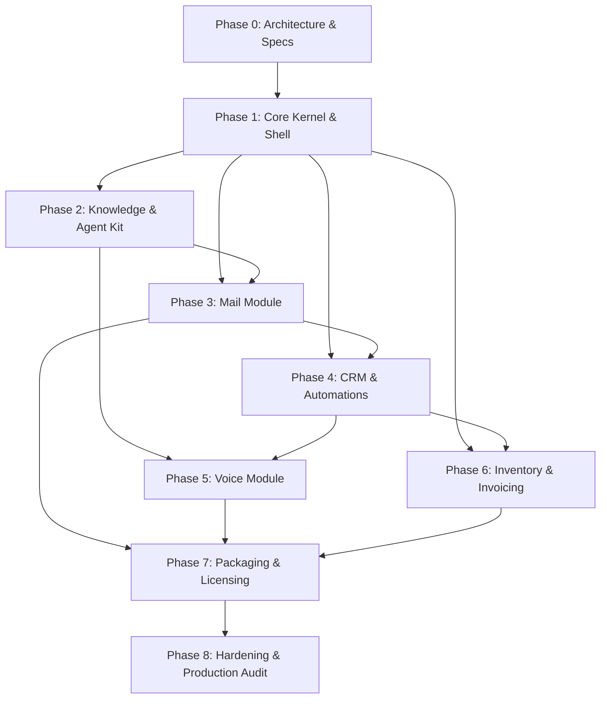

# Comprehensive Engineering Phase Plan & Delivery Gates

Step-by-Step Delivery Roadmap with Verification Standards and Go/No-Go Gates

---

## 1. Phase Dependency Graph

---

## 2. Phase-by-Phase Execution Plan

### Phase 0: Architecture, Data Model, and Decision Records (1 Day) — [COMPLETED]
- **Objective:** Establish the foundational blueprints, database schemas, ADRs, module contract specifications, and risk registry before authoring production code.
- **Deliverables:**
  - `docs/architecture.md` (System layers, request flow, tenancy, deployment targets).
  - `docs/module-contract.md` (Typed `ModuleManifest` specification and lifecycle rules).
  - `docs/data-model.md` (Complete relational schema, pgvector schemas, RLS policies).
  - `docs/ui-ia.md` (Information architecture, shell layout, page inventories).
  - `docs/risk-register.md` (15 ranked risks with mitigation strategies).
  - `docs/adr/001-012` (12 Architectural Decision Records).
  - `docs/phase-plan.md` (Execution schedule and verification criteria).
- **Gate Criteria:** Product owner review and formal approval.

---

### Phase 1: Core Kernel, Tenancy, and Shell (3–5 Days)
- **Objective:** Construct the monorepo foundation, multi-tenant database engine with RLS, authentication, RBAC, event outbox, job runner, brand pack loader, and dynamic module host.
- **Deliverables:**
  - Monorepo initialized with pnpm workspaces, Turborepo pipeline (`turbo.json`), and strict tsconfig presets.
  - PostgreSQL schema migrations for `core_*` tables committed via Drizzle ORM.
  - Row Level Security (RLS) policies and tenant isolation context middleware.
  - Authentication powered by Better Auth (email/password, OAuth callbacks, TOTP 2FA, invitation tokens).
  - Role-Based Access Control (RBAC) middleware verifying permissions from manifests.
  - Transactional Outbox Event Bus (`core_events`) with background dispatcher.
  - Job runner adapter interface with Trigger.dev v3 and BullMQ implementations.
  - White-label presentation shell (`packages/ui`) with CSS token variables and dark mode derivation.
  - Module Host loader in `apps/web`: Dynamic sidebar navigation, route mounting, and entitlements middleware.
  - Scaffolding generator CLI: `pnpm module:create <id>`.
  - Sample reference module (`notes`) validating live enable, disable, and uninstall cycles.
- **Dependencies:** Phase 0 approval.
- **Gate Criteria:**
  - Automated tenant isolation test suite passes (`packages/core/test/isolation.test.ts` proves Tenant B cannot access Tenant A data).
  - Live module toggling demo: Enabling/disabling `notes` adds/removes sidebar links and returns 404 on disabled routes without restarting server.

---

### Phase 2: Knowledge & Agent Kit (2–3 Days)
- **Objective:** Build the first-class AI runtime with tool calling, untrusted data quarantine, pgvector retrieval, approval queues, and CI regression evaluation.
- **Deliverables:**
  - Ingestion pipeline for documents, URLs, and text into `kb_sources` and `kb_chunks`.
  - `pgvector` HNSW index configuration and semantic retrieval query engine with citation tracking.
  - Agent runtime in `packages/agent-kit` leveraging Vercel AI SDK with Anthropic Claude default and BYOK resolution.
  - Declarative tool registry enforcing required permissions, risk tiers (`read`, `write`, `external-send`, `financial`), and idempotency.
  - Central **Approval Queue** UI surface (`/approvals`) with one-click approve, edit, and reject controls.
  - Prompt injection quarantine wrapping untrusted inputs in structured XML data blocks.
  - Observability logging to `agent_runs` (tokens, latency, cost in cents, prompt versions).
  - CI evaluation harness executing against a golden dataset of 100 test scenarios.
- **Dependencies:** Phase 1 complete.
- **Gate Criteria:**
  - Automated prompt-injection test suite passes (50 adversarial jailbreak attempts fail to bypass permissions or exfiltrate data).
  - CI eval report verifies agent category classification accuracy > 95%.

---

### Phase 3: Mail Module (3–5 Days)
- **Objective:** Implement connected inboxes (Gmail, Microsoft Graph, IMAP), AI triage and reply drafting, contact lists, branded templates, and batch campaign sender.
- **Deliverables:**
  - Push-based incremental sync for Gmail (Pub/Sub + history IDs) and Microsoft Graph (delta queries).
  - Mailbox connection management with envelope-encrypted token storage in `core_secrets`.
  - Three-pane inbox UI (`/mail`) with category tabs, thread assignment, and customer CRM context panel.
  - Autonomous triage agent (auto-categorization, priority tagging, entity extraction).
  - Reply drafting agent utilizing tenant brand voice and cited knowledge sources.
  - Audience management (CSV drag-and-drop import with column auto-mapping).
  - Batch campaign sender with warmup throttling, pause/resume cursors, and RFC 8058 `List-Unsubscribe` headers.
  - Deliverability verification dashboard checking SPF, DKIM, DMARC, and MX records.
- **Dependencies:** Phase 1 and Phase 2 complete.
- **Gate Criteria:**
  - End-to-end receipt of real email, automatic AI classification, human approval in queue, and outgoing reply delivery.
  - Simulated 10,000-recipient batch campaign test with forced worker crash at 50% resuming seamlessly with zero duplicate sends.

---

### Phase 4: CRM & Cross-Module Automations (2–3 Days)
- **Objective:** Deliver customer relationship management (contacts, companies, deals, pipelines) and visual workflow automations wired to event bus triggers.
- **Deliverables:**
  - Contacts directory with custom fields, tag management, and activity timeline.
  - Deals board with interactive Kanban drag-and-drop stage progression and table views.
  - Visual Automation Canvas (`/automations`) built with xyflow (React Flow).
  - Trigger, Condition, and Action nodes subscribing to events across all enabled modules.
  - Durable workflow execution engine with step-level JSON logging.
- **Dependencies:** Phase 1 and Phase 3 complete.
- **Gate Criteria:**
  - Saved workflow test: "Inbound customer enquiry email automatically creates a CRM contact, opens a deal stage, drafts a reply, and alerts the deal owner" executes autonomously.

---

### Phase 5: Voice Module (3–5 Days)
- **Objective:** Deliver an intelligent AI phone agent with telephony provisioning, visual call flow builder, realtime speech pipeline with barge-in, and compliance screening.
- **Deliverables:**
  - Twilio provider adapter for telephone number purchasing and SIP routing.
  - Realtime voice pipeline integrating LiveKit Agents, Silero VAD, Deepgram STT, Claude LLM, and Cartesia/ElevenLabs TTS.
  - Natural barge-in: Audio playback terminates instantly when user speech is detected.
  - Visual Call Flow Builder canvas (`/voice/flows/[id]`) with intent branching and tool invocation nodes.
  - Interactive Browser Test Console allowing developers to place simulated WebRTC test calls.
  - Audio recording playback, timestamped synchronized transcripts, and post-call sentiment summaries.
  - Regulatory compliance admin center enforcing calling-hour windows, DNC registry checks, and mandatory AI disclosures.
- **Dependencies:** Phase 1, Phase 2, and Phase 4 complete.
- **Gate Criteria:**
  - Recorded live test call demonstrating voice interaction: Caller checks product availability, agent calls `inv.checkStock`, and schedules a follow-up consultation in the CRM.

---

### Phase 6: Inventory, Invoicing & Finance (3–5 Days)
- **Objective:** Implement operational inventory management with an append-only stock ledger, and complete billing/invoicing with double-entry journal validation.
- **Deliverables:**
  - Item catalog supporting multi-variant matrices, barcodes, units of measure, and reorder points.
  - Multi-warehouse and bin location tracking.
  - **Append-only stock ledger** (`inv_stock_movements`): Balances derived from historical transaction aggregation.
  - Physical stock count reconciliation with automated variance ledger adjustments.
  - Document engine for quotes, sales orders, purchase orders, invoices, and credit notes.
  - Server-side PDF generation using `@react-pdf/renderer` styled with active brand tokens.
  - Stripe payment link integration and manual payment recording.
  - General ledger chart of accounts and journal entry posting with strict `Debit = Credit` mathematical constraints.
  - Assistive inventory agents suggesting purchase orders when stock approaches reorder thresholds.
- **Dependencies:** Phase 1 and Phase 4 complete.
- **Gate Criteria:**
  - Complete operational lifecycle test: Stock received into warehouse → Sales order created → Stock dispatched from ledger → Invoice generated → Stripe payment collected → Ledger balances and double-entry journals verified balanced.

---

### Phase 7: White-Label Packaging, Licensing, and Deployments (2–3 Days)
- **Objective:** Finalize customer brand packs, self-hosted offline licensing, Stripe billing integration, and automated deployment configurations.
- **Deliverables:**
  - Brand pack scaffolding CLI (`pnpm brand:create`) and validator (`pnpm brand:validate`).
  - Production brand pack demonstrating complete re-skinning (colors, fonts, logos, personas, email shells, PDF templates).
  - Stripe subscription billing integration with metered usage reporting and customer portal access.
  - Self-hosted offline licensing system utilizing RSA-4096 signed license files.
  - Docker Compose configuration (`docker-compose.yml`) and multi-stage container Dockerfiles.
  - Vercel one-click deploy blueprints and environment configuration documentation.
  - Demo seed script (`pnpm demo:seed <brand>`) populating realistic data across all enabled modules.
- **Dependencies:** Phases 1 through 6 complete.
- **Gate Criteria:**
  - Deployment of a secondary brand pack from scratch in under 4 hours, verified through visual inspection, email previews, and PDF generation.

---

### Phase 8: Hardening, Security Review, and Runbooks (2–3 Days)
- **Objective:** Execute comprehensive penetration testing, performance budgeting, accessibility audits, and author operational runbooks.
- **Deliverables:**
  - Full penetration test: Verify CSRF, SSRF, SQL injection, RLS bypass, and authorization boundaries across all endpoints.
  - Stress testing: Execute 10,000-recipient email dispatch and concurrent database load tests.
  - WCAG 2.2 AA accessibility audit verifying keyboard navigation, screen reader labels, and color contrast.
  - Disaster recovery drills: Backup and restoration scripts tested against live PostgreSQL snapshots.
  - Operational runbooks: Incident management, provider outage failover, and billing dunning procedures.
- **Dependencies:** Phases 1 through 7 complete.
- **Gate Criteria:**
  - 100% clean security and accessibility audit reports with zero open high or critical vulnerabilities.

---

## 3. Estimated Schedule Summary

| Phase | Description | Estimated Working Days |
|---|---|---|
| **Phase 0** | Architecture, Data Models, ADRs & Strategy | **1 Day** (Done) |
| **Phase 1** | Core Kernel, Tenancy, Shell & Module Host | **4 Days** |
| **Phase 2** | Knowledge Base & Agent Kit Runtime | **3 Days** |
| **Phase 3** | Mail Module (Inbox, Triage, Campaigns) | **4 Days** |
| **Phase 4** | CRM & Automations Workflow Canvas | **3 Days** |
| **Phase 5** | Voice Module (Telephony & LiveKit Agents) | **4 Days** |
| **Phase 6** | Inventory Ledger, Invoicing & Double-Entry | **4 Days** |
| **Phase 7** | Brand Packs, Licensing, Docker & Vercel | **3 Days** |
| **Phase 8** | Security Hardening, Load Testing & Runbooks | **2 Days** |
| **Total** | **End-to-End Enterprise Delivery** | **~28 Working Days** |
