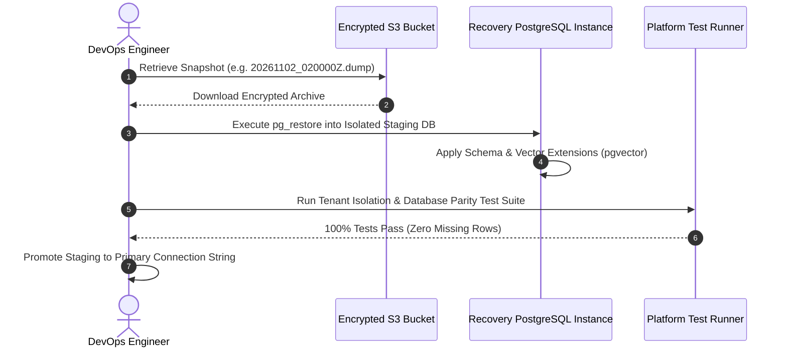

# Operational Runbook: Disaster Recovery, Backup, and Restoration

Database Snapshotting, Point-in-Time Recovery (PITR), and Cold-Start Verification

---

## 1. Backup Topology & Retention Schedule

| Backup Type | Frequency | Retention Window | Storage Target | Encryption |
|---|---|---|---|---|
| **Continuous WAL Archiving** | Real-time stream | 30 days (PITR) | S3 / GCS Object Storage | AES-256 (KMS) |
| **Full Logical Snapshot** | Daily at 02:00 UTC | 90 days | Encrypted Off-Site Bucket | AES-256 (KMS) |
| **Pre-Migration Snapshot** | Automated before CI migration | 14 days | Local Database Host / Neon Branch | AES-256 |

---

## 2. Automated Backup Execution

### Logical Dump via `pg_dump`:
```bash
#!/bin/bash
set -e

TIMESTAMP=$(date -u +%Y%m%d_%H%M%SZ)
BACKUP_FILE="/backups/platform_backup_${TIMESTAMP}.dump"

echo "Beginning database backup to ${BACKUP_FILE}..."
pg_dump -Fc --no-acl --no-owner -h "${DB_HOST}" -U "${DB_USER}" -d "${DB_NAME}" -f "${BACKUP_FILE}"

echo "Uploading snapshot to encrypted cloud storage..."
aws s3 cp "${BACKUP_FILE}" "s3://${BACKUP_S3_BUCKET}/daily/${TIMESTAMP}.dump" --sse aws:kms

echo "Backup complete and verified."
```

---

## 3. Restoration & Point-in-Time Recovery (PITR) Drill



### Restoration Command:
```bash
pg_restore --clean --if-exists --no-acl --no-owner -h "${RESTORE_DB_HOST}" -U "${DB_USER}" -d "${RESTORE_DB_NAME}" "/backups/snapshot.dump"
```

### Post-Restoration Sanity Assertions:
1. Confirm tenant count: `SELECT count(*) FROM core_tenants;`
2. Confirm vector indexes: `SELECT * FROM pg_indexes WHERE indexname = 'idx_kb_chunks_vector';`
3. Confirm double-entry journal balance: `SELECT SUM(debit_cents), SUM(credit_cents) FROM fin_journal_lines;`
