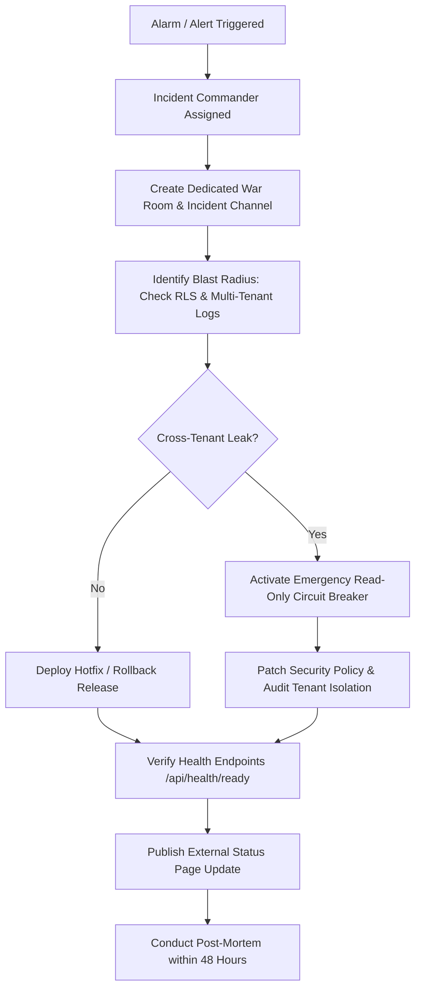

# Operational Runbook: Incident Response and Severity Management

Platform Incident Classification, Escalation Paths, and Mitigation Procedures

---

## 1. Incident Severity Definitions

| Severity | Definition | Target Response | Target Resolution | Escalation Contact |
|---|---|---|---|---|
| **SEV-1 (Critical)** | Core platform outage, cross-tenant data leak, or complete failure of background job dispatch affecting >10% of tenants. | **< 15 minutes** | **< 2 hours** | VP Engineering & Platform Lead |
| **SEV-2 (High)** | Degradation of a major module (e.g. Inbound voice calls failing, batch campaign stall, or Stripe webhook ingestion failure). | **< 30 minutes** | **< 6 hours** | On-Call Lead Engineer |
| **SEV-3 (Medium)** | Non-blocking bug or cosmetic defect affecting a single tenant or isolated UI view with a viable workaround. | **< 4 hours** | **< 2 business days** | Module Engineering Team |

---

## 2. Severity 1 Incident Workflow



---

## 3. Immediate Action Protocols

### Protocol A: Suspected Cross-Tenant Data Leak
1. **Quarantine Tenant Connections:**
   ```bash
   # Terminate active pooled connections immediately
   SELECT pg_terminate_backend(pid) FROM pg_stat_activity WHERE datname = 'platform_db' AND pid <> pg_backend_pid();
   ```
2. **Verify Database Row Level Security (RLS) Enforcement:**
   ```sql
   -- Confirm RLS is enabled and forced across all tables
   SELECT tablename, rowsecurity FROM pg_tables WHERE schemaname = 'public';
   ```
3. **Audit Access Logs:** Query `core_audit_log` filtering by suspect `tenant_id` and timestamp window.

### Protocol B: Background Job Backpressure or Deadlock
1. Inspect dead-letter queue count:
   ```sql
   SELECT count(*) FROM core_events WHERE status = 'failed' OR status = 'dead';
   ```
2. Replay dead-letter events with idempotency keys:
   ```sql
   UPDATE core_events SET status = 'pending', attempts = 0 WHERE status = 'failed' AND attempts < 5;
   ```
